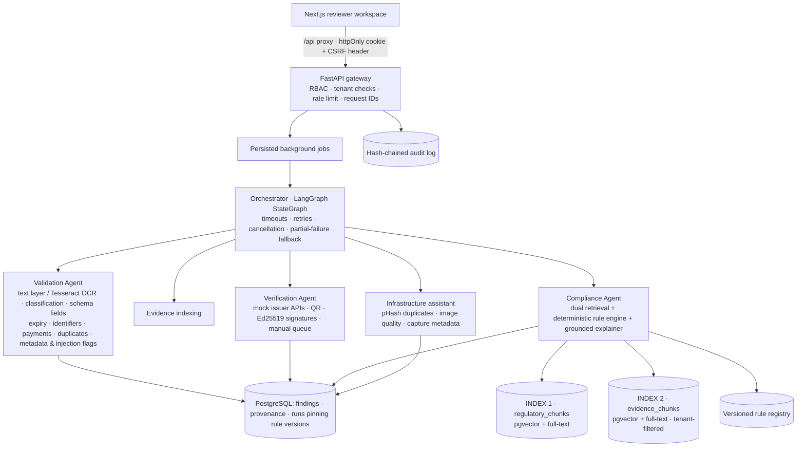

# AICTE IntelliScrutiny — working prototype

> **Independent demonstration prototype.** Not affiliated with, endorsed by, or an official product of AICTE.
> Every institution, person, issuer, certificate and regulatory clause in the demo is **synthetic**. Findings are
> advisory and evidence-linked; the system never approves or rejects anything.

A working model of AI-assisted scrutiny for Extension of Approval (EoA) applications. It covers document
extraction, issuer verification, dual-index RAG compliance checks, a versioned rule engine, human review
and a hash-chained audit trail.

## Quick start

### Option A — Docker Compose (PostgreSQL + pgvector, Tesseract OCR)

```bash
cp .env.example .env          # optional; sensible demo defaults apply without it
docker compose up --build
```

Open http://localhost:3000. The API docs are at http://localhost:8000/api/v1/docs.

### Option B — local, without Docker (SQLite fallback)

```bash
# backend
cd backend
python -m venv .venv && .venv/Scripts/activate      # Windows; use .venv/bin/activate on macOS/Linux
pip install -r requirements.txt
uvicorn app.main:app --port 8000                    # runs migrations, then seeds synthetic data

# frontend (second terminal)
cd frontend
npm install
npm run build && npx next start -p 3000             # or: npm run dev
```

Sign in with any synthetic account. The password for all of them is `Demo@12345`:

| Account | Role |
|---|---|
| `officer@scrutiny.example` | Scrutiny officer (reviews findings, runs the demo) |
| `verifier@scrutiny.example` | Issuer-verification officer (manual confirmation queue) |
| `regadmin@scrutiny.example` | Regulatory administrator (rules, sources) |
| `sysadmin@scrutiny.example` | System administrator (users, connectors, settings) |
| `auditor@scrutiny.example` | Read-only auditor |
| `uploader@sits.example` / `uploader@ece.example` | Institution uploaders (own institution only) |

### Tests

```bash
cd backend && python -m pytest        # 37 tests: permissions, validation, retrieval, workflow, rules, audit
cd frontend && npx tsc --noEmit
```

## Seven-step guided demonstration

Sign in as the scrutiny officer, go to **Guided demo**, and click **Run guided demo**. This creates a new synthetic application, uploads 10 files through the real upload pipeline, submits it, and runs the orchestrator. The timeline updates live. Then walk through the steps:

1. **Submit**: a fictional institute files an EoA application for 2027-28.
2. **Document intelligence**: open the text layer or OCR output, the classification, and the schema-constrained fields. Click a field to highlight its source region on the page facsimile.
3. **Regulatory Knowledge Index**: the clause in force on the session reference date (1 July 2027) is retrieved. The superseded 2026-27 edition is excluded, though it is still used for historical as-of queries.
4. **Institutional Evidence Index**: retrieval covers the institute's prior approval, its open deficiency from last year, and its current documents. It is filtered to that tenant in SQL before ranking.
5. **Exact checks and findings**: the rule engine compares extracted values with relational records. The scenario produces these findings:
   - The fire certificate expired before the session starts.
   - The institution name on one certificate does not match.
   - CSE intake is 180 against 120 approved last year.
   - Two affidavits are byte-identical duplicates.
   - The occupancy certificate's metadata suggests editing, and it contains hidden "ignore previous instructions" text. That text is flagged and never obeyed.
   - The building plan is missing, and two photographs show the same scene.
6. **Issuer verification**: mock issuers return EXPIRED (fire), MISMATCH_DETECTED (accreditation) and SOURCE_UNAVAILABLE (municipal registry, which is routed to the manual queue and **not** treated as forgery). The QR code and Ed25519 signature checks verify the fire certificate, and flag the occupancy certificate's signature for manual review.
7. **Human review and audit**: accept, dispute or annotate findings, request evidence, send items for manual issuer confirmation, then record an outcome (rectification requested or ready for further scrutiny). Every action appears in the hash-chained audit trail.

To exercise the actual OCR pipeline, untick **fixture text** before running. With Tesseract installed (Docker image), the scanned affidavit is OCR'd. Without it, the page is reported as unreadable rather than guessed. Fixture text, when used, is labelled `synthetic-fixture` everywhere it appears.

You can also do it by hand: under **Applications → New application**, upload the files from **Download synthetic sample pack** (each file's declared type is listed in `manifest.csv`), then submit and process.

## Architecture



| Layer | Implementation |
|---|---|
| API | FastAPI, SQLAlchemy 2, Alembic migration `0001_initial` (creates the `vector` extension plus HNSW and GIN indexes on PostgreSQL) |
| Orchestration | LangGraph `StateGraph` with an in-memory checkpointer. Step progress is persisted in `jobs.steps`. Each node has a timeout and bounded retries; a failed node writes a `PIPELINE_STEP_FAILED` manual-review finding and the graph continues |
| Retrieval | Two tables with separate code paths. Hybrid ranking fuses pgvector cosine and `ts_rank_cd` keyword scores (reciprocal-rank fusion), with metadata filters for effective dates, supersession and tenant. On SQLite the same logic runs in Python, for development only |
| Embeddings | Adapter in `app/rag/embeddings.py`. The default `local-hashing-v1` is offline and deterministic, but **lexical, not semantic**, and is labelled as such. Switch with `EMBEDDING_PROVIDER=sentence-transformers` or `http`; chunks record their model, so stale chunks are reported for re-indexing |
| Rules | JSON condition DSL (`app/rules/engine.py`) with no code execution. Versions are immutable once created, go through DRAFT → PENDING_APPROVAL → APPROVED, and carry labelled test cases. Each validation run stores the exact rule versions it used |
| Explanations | Default: a deterministic, template-based explainer built only from retrieved citations and comparison outcomes. If `ANTHROPIC_API_KEY` is set, Claude phrases the explanation from the same inputs: JSON-schema output, untrusted text delimited, and any clause reference outside the supplied citations is rejected in favour of the template |
| Frontend | Next.js 15, TypeScript, Tailwind, Radix-based shadcn-style primitives, Framer Motion (honours reduced motion), Recharts, Lucide |

### Security and governance

- **Access control:** RBAC is enforced in the backend with six roles. Object-level checks return 404 for another tenant's objects, and evidence search scope cannot be widened by the client.
- **Sessions:** cookies are httpOnly, SameSite=Strict, and require a custom anti-CSRF header on mutations. Bearer tokens are accepted for API clients.
- **File access:** files are served through short-lived signed URLs bound to both the user and the document, and authorization is re-checked on every download.
- **Upload handling:** uploads go through magic-byte type validation and size limits, and the hook point for malware scanning (ClamAV via `CLAMAV_HOST`; otherwise only the EICAR test signature is detected) leaves infected files QUARANTINED. Each file gets a SHA-256 hash. Fernet encryption at rest is optional (`STORAGE_ENCRYPTION_KEY`).
- **Logs and indexing:** PII is redacted in logs and stripped before evidence text is embedded.
- **Prompt injection:** uploaded text is treated as data. Instruction-like text is detected and flagged, and model output is validated against its grounded inputs.
- **Audit:** events form a SHA-256 chain, and `/audit/verify-chain` recomputes it.
- **Environment isolation:** `APP_ENV=production` refuses to seed data, disables the demo, enforces separation of duties for rule approval, and refuses weak secrets.

## API overview (`/api/v1`, full OpenAPI at `/api/v1/docs`)

| Area | Endpoints |
|---|---|
| Auth | `POST /auth/login`, `POST /auth/logout`, `GET /auth/me` |
| Applications | `GET/POST /applications`, `GET /applications/{id}`, `POST …/submit`, `POST …/process` (Idempotency-Key), `POST …/transition`, `POST …/review-outcome`, `POST …/assign`, `POST …/comments`, `GET …/activity`, `GET …/runs`, `GET …/compliance` |
| Documents | `POST /applications/{id}/documents` (multipart), `GET /documents`, `GET /documents/{id}`, `GET /documents/{id}/url`, `GET /files/{token}` |
| Findings and review | `GET /findings`, `GET /findings/{id}`, `POST /findings/{id}/actions` (ACCEPT, DISPUTE, NOTE, REQUEST_EVIDENCE, MANUAL_ISSUER_CONFIRMATION, RECOMMEND_INSPECTION, RESOLVE, REOPEN) |
| Verification | `GET /verification/requests`, `POST /applications/{id}/verify`, `POST /verification/requests/{id}/manual-outcome`, `POST …/retry` |
| Retrieval | `GET /rag/status`, `POST /rag/search/regulatory` (with `as_of`), `POST /rag/search/evidence` |
| Rules and sources | `GET/POST /rules`, `POST /rules/{id}/submit`, `…/approve`, `…/retire`, `…/test`; `GET/POST /regulatory/sources`, `…/reindex`, `…/supersede`, `…/chunks` |
| Operations | `GET /dashboard/metrics`, `GET /reports/summary`, `GET/POST /reports/evaluations`, `GET /audit`, `GET /audit/verify-chain`, `GET /jobs/{id}`, `POST /jobs/{id}/cancel`, `POST /jobs/{id}/retry`, `GET /search`, `GET /notifications` |
| Admin | `GET/POST/PATCH /admin/users`, `GET /admin/roles`, `GET/PUT /admin/settings`, `GET /admin/retention/preview`, `POST /admin/retention/execute`, `GET /admin/system`, `GET/PATCH /connectors`, `POST /connectors/{id}/health-check` |
| Demo | `GET /demo/scenario`, `POST /demo/run`, `GET /demo/sample-pack` |

Errors always use this shape: `{"error": {"code", "message", "request_id", "details"}}`.

## What this prototype is not

- **No official text.** It contains no official AICTE regulatory text. The demo corpus and rules are synthetic and labelled. Real handbooks can be imported under **Regulatory rules → Sources**, but marking a source official is an explicit, audited administrator assertion.
- **No live issuer integrations.** Mock connectors answer only from labelled synthetic registries. The DigiLocker-compatible connector stays disabled until official authorization and credentials exist.
- **No real-world accuracy claims.** Evaluation metrics (Reports) are computed on generated fixtures that share templates with the extractor. They show the pipeline behaves correctly, not that it is accurate on real documents.
- **Limited image analysis.** No object-detection model is configured, so infrastructure checks are limited to duplication, quality and capture metadata. A photograph is never treated as proof of compliance.
- **Single-node jobs.** Background jobs run in-process (persisted in the DB, recovered as FAILED on restart). `app/services/jobs.py` is the seam for a real queue.

## Troubleshooting

| Symptom | Fix |
|---|---|
| `next dev`/`next build` hangs or complains about the workspace root | A stray `package.json`/lockfile in a parent folder (e.g. your home directory) confuses Next.js. `next.config.mjs` pins `outputFileTracingRoot` and `turbopack.root` to `frontend/`; delete the stray files if problems persist |
| Port 3000 already in use | Stop the other process, or run `npx next start -p 3001` |
| `npm install` reports corrupted tarballs / `ENOTEMPTY` on Windows | Antivirus file locking. Delete `node_modules` and reinstall |
| Affidavit shows "OCR engine is unavailable" | Tesseract isn't installed locally. Use Docker, install Tesseract (set `TESSERACT_CMD` if it's not on PATH), or tick **fixture text** |
| Login redirects back to `/login` | The frontend must reach the backend through its `/api` proxy. Check `BACKEND_URL` (default `http://localhost:8000`) and that the API is running |
| Want a clean demo | Delete `backend/data/` (SQLite) or run `docker compose down -v`, then restart |
| Changed `EMBEDDING_DIM` | The pgvector column dimension is set by the migration. Recreate the database and re-index |
